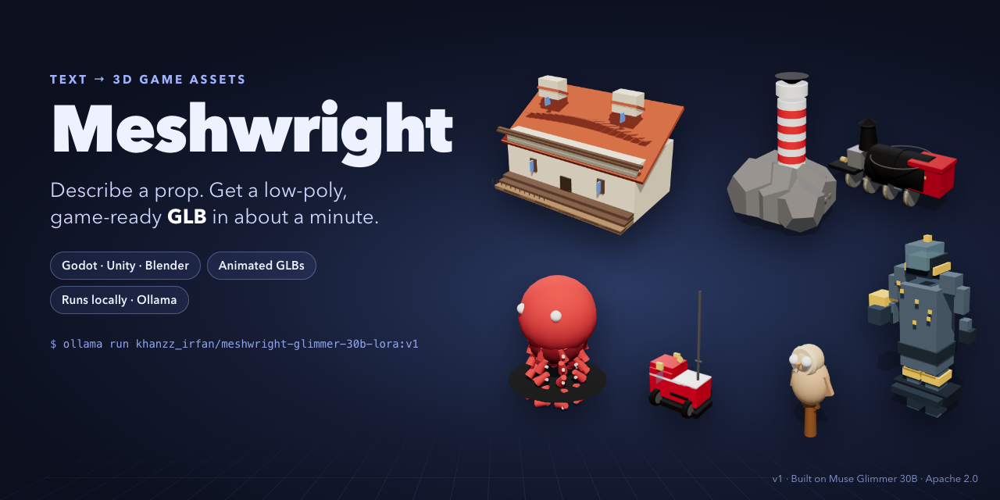
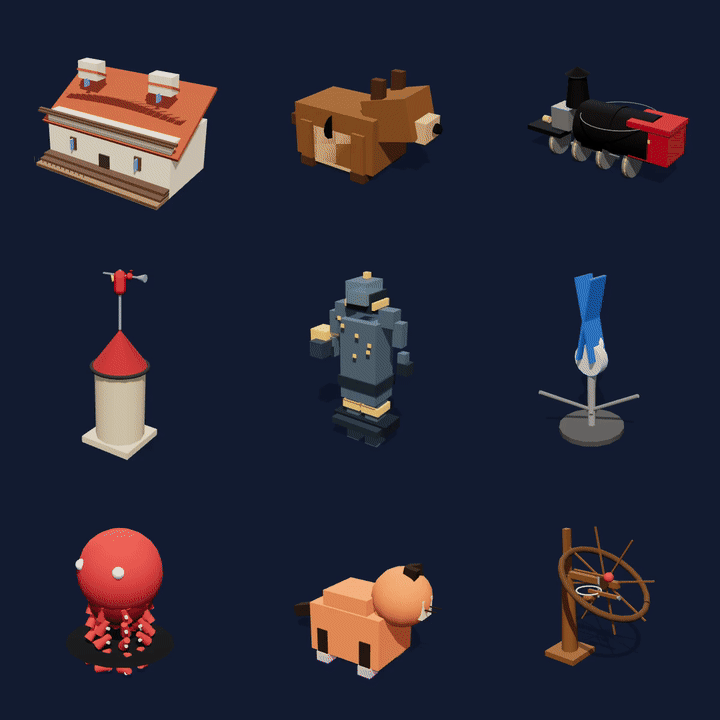
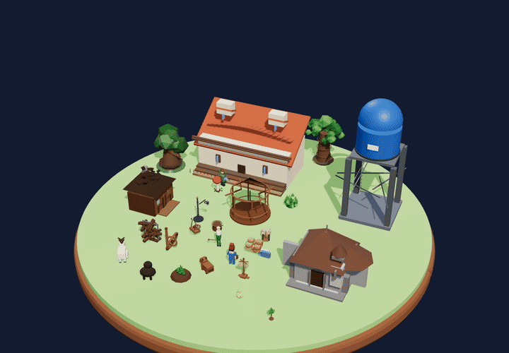
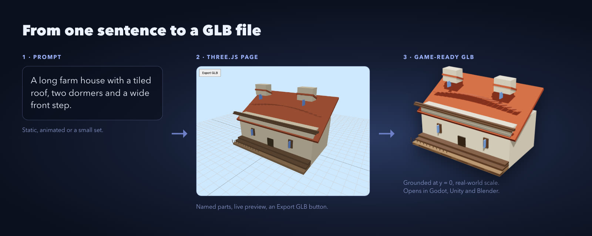
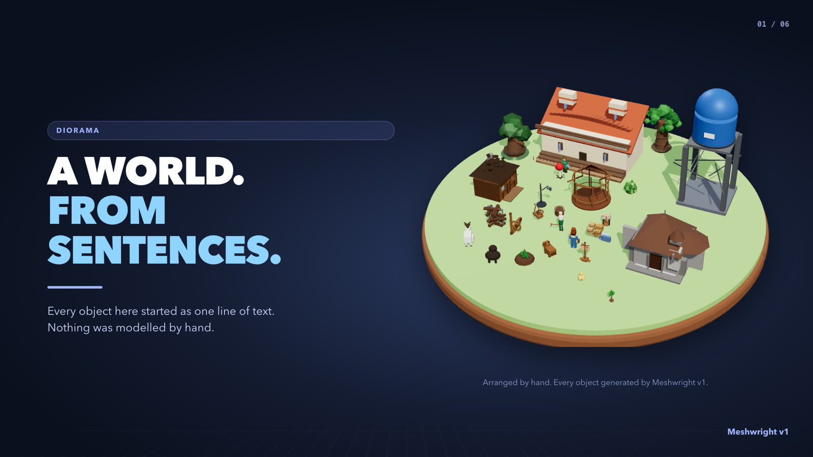
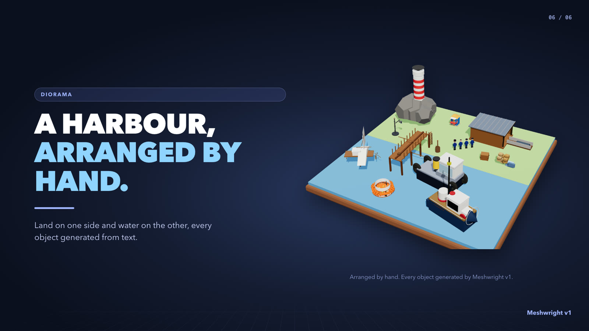
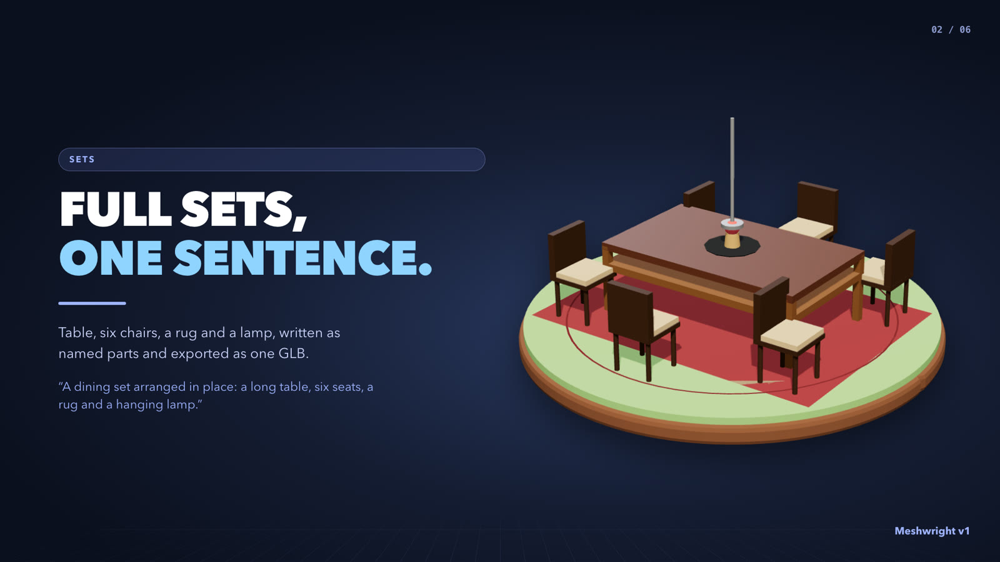
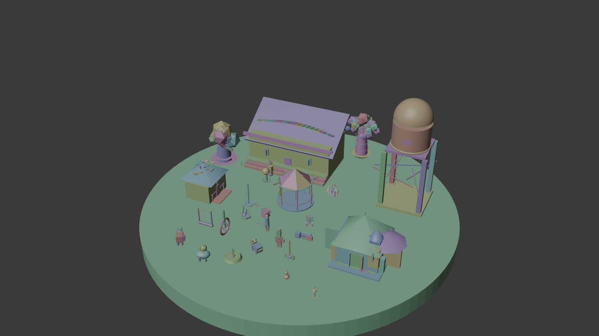
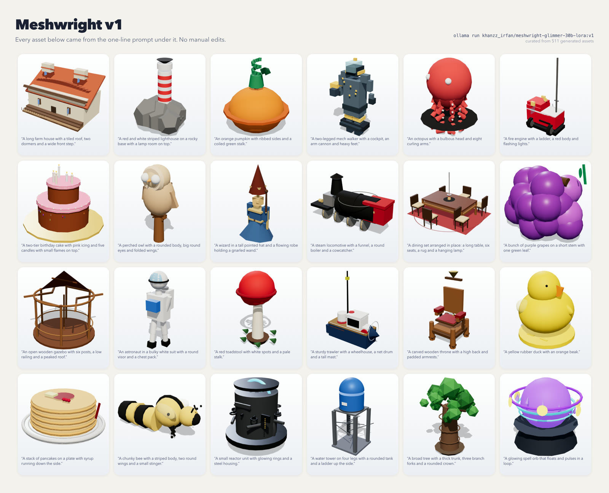

# Meshwright



**Describe a prop in one sentence. Get a low-poly, game-ready GLB.** Meshwright writes a small Three.js page that
builds the asset from named parts, previews it and has an **Export GLB** button. The file opens in Godot, Unity
and Blender; animated requests carry their animation inside the GLB. Built on Muse Glimmer 30B, Apache 2.0, runs
locally with Ollama.

```bash
ollama run khanzz_irfan/meshwright-glimmer-30b-lora:v1 --think=false "A stone well with a wooden roof and a bucket"
```

[Model on Hugging Face](https://huggingface.co/khanzzirfan/meshwright-glimmer-30b-lora) ·
[Ollama](https://ollama.com/khanzz_irfan/meshwright-glimmer-30b-lora) ·
[Training set](https://huggingface.co/datasets/khanzzirfan/meshwright-glimmer-30b-lora-distill) ·
[Release notes](docs/15-release.md)

> Built on Muse Glimmer 30B (Apache 2.0). Independent project, not affiliated with or endorsed by Meta.



## Showcase



*Arranged by hand. Every object in the scene was generated by Meshwright v1 from one line of text.*



| | |
|---|---|
|  |  |
|  |  |



The images are curated from 511 generated assets and rendered from the exported GLBs with studio lighting; the
geometry is untouched. **Works in Blender:** all 40 GLBs used in this material import into Blender 5.2
([report](docs/media/blender_report.json)); the bottom-right image is the village imported and rendered
in Blender with each part in its own colour.

## Results (v1)

48 held-out prompts, thinking off, Apple M3 Max, validated by loading the page in headless Chromium, clicking
Export GLB and checking the file.

| Setup | Valid GLB | Assembled | Seconds per asset |
|---|---|---|---|
| Single sample (`ollama run`), 4 seeds | 87.5-97.9% | 56-75% | about 60-70 |
| Generator (`scripts/glb_generate.py`: adaptive best of 3, repair, ground drop) | 47/48 (97.9%) | 44/48 (91.7%) | 84.5 |

Visual quality is not blind-rated yet. v1 adds no new weights: it is Muse Glimmer 30B with a system prompt frozen
after three benchmark rounds. v2 trains a LoRA on the model's own filtered outputs (the 462-row training set
above). The `:v1` tag runs on Apple Silicon (MLX build); a cross-platform GGUF tag is planned
([docs/15](docs/15-release.md)).

## Run it yourself

**Just the model:** install [Ollama](https://ollama.com) (0.32.7 or later, Apple Silicon) and run the command at the top.
Save the reply's HTML block as `asset.html`, open it in a browser and click **Export GLB**.

**The full generator**, the setup behind the 47/48 result: it validates every answer in headless Chromium, retries
or repairs failures, drops the asset onto the ground and cleans part names so the GLB imports into Blender.

```bash
git clone https://github.com/khanzzirfan/meshwright-glimmer-30b-lora.git && cd meshwright-glimmer-30b-lora
python3 -m venv .venv && .venv/bin/pip install -r requirements.txt
npm install && npx playwright install chromium
ollama pull muse-glimmer:30b-mlx
.venv/bin/python scripts/glb_generate.py "A wooden rowing boat with two oars" --kind static --out-dir my_assets
```

`--kind animated` asks for an animation clip inside the GLB; `--kind set` for a small group of items.

## How it works

1. **Prompt.** A frozen system prompt ([prompts/system_glb_v3.txt](prompts/system_glb_v3.txt)) asks for one
   self-contained Three.js page: named low-poly parts under one `asset` group, real-world metres, an Export GLB
   button, and animation tracks the GLB exporter keeps.
2. **Validate.** [scripts/validate_scenes.mjs](scripts/validate_scenes.mjs) loads the page in headless Chromium,
   clicks Export GLB and checks the file with [scripts/glb_check.mjs](scripts/glb_check.mjs): parses, has
   triangles, no NaN transforms or vertices, and whether the parts are assembled into one grounded object.
3. **Pick or repair.** [scripts/glb_generate.py](scripts/glb_generate.py) samples until an answer is valid,
   assembled and within 5,000 triangles (up to 3 samples), otherwise feeds the error back for one repair turn.
4. **Deliver.** The GLB is dropped onto y = 0 and part names are cleaned so Blender 5.2 imports it.

## Repository layout

| Path | What is there |
|---|---|
| [scripts/](scripts/) | Generator, validator, GLB checks, repair, benchmark, promo renderers |
| [prompts/](prompts/) | System prompts; `system_glb_v3.txt` is the released one |
| [bench/](bench/) | The 48 held-out eval briefs, 12 dev briefs, 540 distillation briefs, model rows |
| [release/v1/](release/v1/) | Published files: Ollama Modelfile, Hugging Face cards, launch kit |
| [docs/](docs/README.md) | Release notes, benchmark history, developer guide |
| [tests/](tests/) | Python and Node tests; `bash scripts/check.sh` runs them all offline |
| [ralph/](ralph/) | Task files for the [Ralph](https://github.com/subsy/ralph-tui) coding-agent loop that built most of the tooling |

## Documentation

- [docs/15-release.md](docs/15-release.md): what v1 is, names, known issues, the plan for v2
- [docs/14-glb-improvement.md](docs/14-glb-improvement.md) and [docs/13-glb-code-track.md](docs/13-glb-code-track.md):
  how the numbers above were measured
- [docs/developer-guide.md](docs/developer-guide.md): every script and its flags
- [docs/README.md](docs/README.md): all docs, current and archived

## Licence and credits

Apache 2.0 ([LICENSE](LICENSE)). Built on [Muse Glimmer 30B](https://huggingface.co/meta-models/Muse-Glimmer-30B)
by Meta Superintelligence Lab (Apache 2.0); "Muse" identifies the base model only. This is an independent project,
not affiliated with or endorsed by Meta. Generated pages load [three.js](https://threejs.org) (MIT). See
[NOTICE](NOTICE) for third-party data used in the research tracks. Assets you generate are yours to use.
