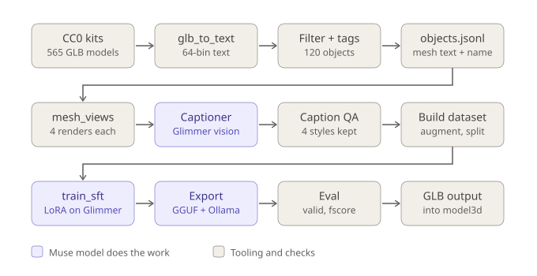
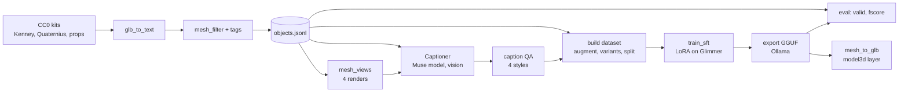

# 00. Architecture

> **Archived.** Part of the research history behind Meshwright v1; kept for reference and not current. See [15-release.md](15-release.md) for the release and [README.md](README.md) for all docs.

One page that says what this project is, how the parts fit, what exists, what is measured and what is not.
Status and the to-do list live in [../NEXT-STEPS.md](../NEXT-STEPS.md); the file map is [../INDEX.md](../INDEX.md).
Last reviewed 3 Nov 2026. Anything marked **not measured** or **unverified** has not been checked.



## 1. Goal

Train a small Muse-based model that turns a text prompt into a low-poly 3D asset, and publish it.
The reference is ccore's Qwen3.5-4B-3D-Coder. Our version differs in three ways:
- the published model is a **Muse** model (Muse Glimmer 30B, Apache 2.0), not a Qwen model;
- the training data is **real CC0 3D assets**, not another model's output;
- every output is **measured** by a validator, a similarity score to the real asset, and a render.

What is published is a fine-tuned student. The teacher or captioner never ends up in the file. This matters for
the pitch: a Qwen model taught by Muse is a Qwen fine-tune; to claim "a Muse model" the Muse model must be the student.

## 2. Two tracks

| | Mesh track (current focus) | Three.js-code track (earlier, kept as fallback) |
|---|---|---|
| Output | a text mesh (`v`, `c`, `f` lines) that converts to a GLB | one self-contained HTML file using Three.js 0.160.0 |
| Training data | CC0 GLB kits, converted to text | teacher-written scenes, filtered by rendering them |
| Teacher | none for meshes; a Muse model only writes captions | Glimmer locally, Spark Open on Baseten |
| Quality gate | `mesh_validate` + `mesh_quality` | headless-Chromium render check (`validate_scenes.mjs`) |
| Docs | [08-mesh-track.md](08-mesh-track.md) | [01](01-licensing.md) to [07](07-local-glimmer.md) |
| Ralph PRDs | 5 and 6 | 1 to 4 (parked) |

## 3. Mesh track, stage by stage

Text mesh format (all coordinates integers 0..63, longest side spans the cube, object stands on y=0, centred on x and z):
```
v 43 63 17      vertex
c #5a3b2e       starts a colour group
f 1 2 3         triangle, 1-based vertex numbers, uses the latest colour group
```

| # | Stage | Script | In → out | Status |
|---|---|---|---|---|
| 1 | Convert kits | `scripts/glb_to_text.py` | GLB kits → `data/mesh/assets.jsonl` | built, tested, run: 565 meshes |
| 2 | Filter | `scripts/mesh_filter.py` | assets → `data/mesh/objects.jsonl` | built, run: 120 objects (name-derived captions) |
| 3 | Preview | `scripts/preview_mesh.mjs` | text meshes → contact sheet PNG | built, used |
| 4 | Validate a mesh | `scripts/mesh_validate.py` | model answer → ok or a reason | built, tested; passes all 120 real meshes |
| 5 | Score quality | `scripts/mesh_quality.py` | answer + real mesh → fscore, iou, face ratio | built, tested |
| 6 | Baseline | `scripts/mesh_baseline.py` | captions → untrained Glimmer answers → scores | built, run: 9 of 30 valid, 0 detailed |
| 7 | Tags, augment, GLB, views, caption, dataset, eval | PRD 5 stories | see [ralph/README.md](../ralph/README.md) | **planned, not built** |
| 8 | Caption styles, QA, bake-off, corpus, variants, kit intake, report | PRD 6 stories | see PRD 6 | **planned, not built** |
| 9 | Train | `scripts/train_sft.py` | `train.jsonl` → LoRA | exists for the code track; **not run**, **not adapted to meshes** |
| 10 | Export and serve | `scripts/export_gguf.sh` | LoRA → GGUF → Ollama | exists; **not run**; Glimmer support unverified |



## 4. Models and their roles

| Role | Model | Why | Status |
|---|---|---|---|
| **Student** (the published model) | Muse Glimmer 30B | Apache 2.0; the only way to ship "a Muse model" | public BF16 weights, llama.cpp GGUF support and an Unsloth fine-tuning path found (section 10); **not yet tried here** |
| Baseline ("before") | the same untrained Glimmer | the before/after has to be the same model | measured locally in Ollama (`muse-glimmer:30b-mlx`) |
| Captioner | Glimmer first; DeepSeek v4.1 Flash and MiniMax M3.1 Flash as a quality check | captions only describe real assets; keeping Glimmer keeps the pipeline Muse | not run; NVIDIA lists Glimmer as accepting images (**unverified by a call**) |
| Tooling author (Ralph) | free NVIDIA NIM models: DeepSeek v4.1 Flash, Nemotron, MiniMax, GLM, Kimi | dev tooling is not part of the claim | DeepSeek struggled with tool calls; the others untested |
| Spark Open | optional captioner | strong, on Baseten | licence unread; used in the code track only |
| Not used | Meta API contributor tier | terms unsuitable | excluded |

Alternative students (Qwen3.5-4B and other small open models) train cheaply and can prove the pipeline, but the result
is not a Muse model. Suggested order: prove on a small model, then train Glimmer once the data is good.

## 5. Data and where it lives

| Source | Location | Licence | Count |
|---|---|---|---|
| Kenney car-kit, city-kit-commercial, city-kit-roads | local copy of the packs | CC0 (LICENSE.txt in each pack) | 186 models |
| Quaternius downtown, medieval, stylized-nature megakits | local copy of the packs | CC0 | 397 |
| Prop library | a private prop library | 30 Quaternius `q-*` (CC0); 13 other props (14 meshes) with an unconfirmed licence removed on 22 Nov 2026 | 30 |

565 kept after de-duplication from 1,166 GLB files (the extra files are `clay/` untextured copies, skipped). The filter then keeps
120 standalone objects (furniture, props, food, vehicles, plants, buildings) and drops 431 modular pieces such as road tiles,
sidewalks, brick columns and cornices by name, plus 11 flat and 3 near-empty meshes. Triangles per mesh: median 128, p90 924, max 1,986.

Working files (all under `data/mesh/` and `eval/`, gitignored): `assets.jsonl`, `objects.jsonl`, `preview.png`,
`baseline_pairs.jsonl` and `.png`, `eval/mesh_baseline/` (one JSON per caption, `summary.json`, `quality.json`).

## 6. Quality gates and metrics

- **Valid** (`mesh_validate`): parses, 8+ vertices and 12+ triangles, indices in range, within 0..63, not flat, fills the cube, most vertices used.
- **fscore** (`mesh_quality`): surface samples within 4 bins (about 6% of size) of the real mesh, best over 4 quarter turns and a mirror. Main shape score.
- **iou**: stricter voxel overlap, for reference. **face_ratio**: generated over real triangle count.
- **detailed** = valid and fscore ≥ 0.5 and face_ratio ≥ 0.25.
- Not yet: whether a "chair" looks like a chair to a person, and a blind scoring by a vision model.

## 7. Measured so far

Untrained Glimmer (`muse-glimmer:30b-mlx`, local), 3-shot, thinking off, 9,000-token cap, **30 held-out captions** (3 Nov 2026):

| Result | Count |
|---|---|
| valid | 9 of 30 (30%) |
| detailed (valid, fscore >= 0.5, face ratio >= 0.25) | **0 of 30** |
| `bad_line` | 9 |
| `bad_face` | 7 |
| `out_of_range`, `flat`, `small_span`, `too_small` | 2, 1, 1, 1 |

- Median fscore of the 9 valid answers 0.17 (best: cone 0.88); median face ratio 0.20, so valid answers are about 5 times coarser than the real assets.
- 11 of 30 answers hit the 9,000-token cap and all 11 are invalid: Glimmer keeps emitting vertices and does not stop.
- Median 82 seconds per answer, 44 minutes in total.
- Weak spots: plants, grass, doors, rocks and props mostly fail; simple solids (cone, box, crate) pass.
- Caveat: several captions repeat (door, plant, clover, rock medium appear twice) because different objects share a name-derived caption. That is the caption weakness the PRD 6 work fixes, and it makes some low scores unfair.

Code track: a 51-brief Glimmer pilot started and was interrupted; Spark Open on Baseten covered 30 briefs (28 passed the render check,
see [baseten-spark-open.md](baseten-spark-open.md)). Training, export and evaluation have **not** been run on either track.

## 8. Tooling and how work is done

- **Ralph** runs one coding agent per story, offline, with no commits (`autoCommit = false`). Mesh PRDs: `ralph/src/prd-05-mesh.json` (6 stories),
  `ralph/src/prd-06-captions-corpus.json` (9). Run `ralph/run-all.sh --only 5`, then `--only 6`. PRD 6 edits files PRD 5 creates, so order matters.
- Gate for every story: `bash scripts/check.sh` (syntax checks plus pytest and node tests, offline). Currently 15 tests pass.
- Ollama runs Glimmer locally (about 40 tokens per second on the M3 Max); the NVIDIA free endpoint (`integrate.api.nvidia.com`) hosts models for Ralph and may host Glimmer.
- Nothing in this repo is committed; `muse-threejs` has no commits yet.

## 9. Open questions and risks

| Question | Why it matters | How to settle |
|---|---|---|
| Can Glimmer be fine-tuned and exported? | If not, the "Muse model" claim fails | **Researched, looks yes** (section 10); settle it by running a small LoRA and a GGUF conversion |
| Is the Spark Open licence compatible with training on its outputs? | Only matters if Spark Open writes captions | read the licence |
| NVIDIA free-endpoint terms for using outputs in training | Same | read the terms before using it at scale |
| Does Glimmer on NVIDIA accept images, and how fast is it? | Decides if Glimmer can caption from renders | run `scripts/nim_smoke.py` with your key |
| Licence of the 13 non-`q` Prop library | They are in the training data now | confirm the source or drop them |
| Is 120 objects enough? | Probably not alone | augmentation plus more CC0 kits (furniture, food, props, characters) via `ingest_kit` |
| Narrow variety (city and nature skew) | A model may produce tiles when asked for a chair | more kits, category balance in the corpus report |
| Texture-atlas kits export grey | Colour is lost for cars and some nature pieces | accept shape-only, or sample the atlas per face |
| Baseline sampling uses a 9,000-token cap | Runaway answers cost about 3 minutes each | lower the cap to about 4,000 on the next run |

## 10. Can Glimmer be trained and published? (researched 3 Nov 2026)

Sources: Hugging Face model card `meta-models/Muse-Glimmer-30B`, NVIDIA's model page, Unsloth's Muse Glimmer docs, Meta's developer blog.
Everything here comes from those pages; none of it has been tried on this machine.

| Question | Finding |
|---|---|
| Architecture | **Dense** causal transformer, 29.6B parameters including a 1.8B vision encoder: 52 layers, hidden size 6,656, 32 query and 2 KV heads, sliding window 2,048, vocabulary 202,048. Not a mixture of experts (an earlier worry in this project was wrong). |
| Weights | Public on Hugging Face, no gating mentioned: `meta-models/Muse-Glimmer-30B` (BF16, about 58 GB). The local Ollama copy is an nvfp4 build for inference and is **not** what you train; you need the BF16 repo. |
| Licence | Apache 2.0 for all artifacts. A separate Usage Policy (`USAGE_POLICY.md`) lists prohibited uses (illegal activity, safety circumvention, deception, weapons and similar); it is **silent on fine-tuning, derivatives, the "Muse" name and training other models on outputs**. NVIDIA's page also cites the NVIDIA Open Model Agreement and API Trial Terms for its hosted service. |
| Fine-tuning | Unsloth's page says you can "fine-tune Meta's Muse Glimmer-30B with Unsloth on a 24GB card" and links two free Kaggle notebooks (2x T4). It does not say whether that is LoRA, QLoRA or full fine-tuning, or give training settings. The model card does not mention PEFT or TRL; the model tree lists 28 adapters and 64 finetunes, so others have done it. |
| Transformers | The card loads it with `AutoModelForMultimodalLM` and `AutoProcessor`; no minimum transformers version is stated (`pip install -U transformers accelerate`). `train_sft.py` loads a causal LM and will need adapting. |
| GGUF export | llama.cpp added the `muse-glimmer` architecture in release b10353; Meta and Unsloth publish GGUFs (`unsloth/Muse-Glimmer-30B-GGUF`). Images need the separate `mmproj` file. Converting our own merged model is **untested**. |
| Chat template | Use the tokenizer's `apply_chat_template`. Default sampling: temperature 1.0, top_p 0.95, top_k 64. Local Ollama reports thinking levels low to max with **default high**; the baseline here ran with thinking off, which may understate Glimmer. |

Rough compute (my estimate, not from the pages): BF16 LoRA needs an 80 GB card (A100 or H100) because the weights alone are about 58 GB; QLoRA through Unsloth should fit 24 to 48 GB. Our meshes are short (median about 2,200 characters, roughly 1,000 to 1,500 tokens), so sequence length is not the constraint.

Naming (my reading, not legal advice): Apache 2.0 lets you publish a fine-tune but does not grant trademark rights, and neither the card nor the Usage Policy addresses naming. Safest wording is "fine-tuned from Muse Glimmer" in the description and an independent model name.

Still to do to turn "looks yes" into "yes": (1) a 100-step LoRA on 20 meshes with Unsloth or TRL to confirm it trains and the loss falls; (2) merge, convert with llama.cpp, quantise and load in Ollama; (3) rerun the baseline with thinking on and a lower token cap, so before and after are comparable.

## 11. Decisions so far

1. The student is Glimmer so the result can be called a Muse model; other small models are for fast proofs only.
2. Training data is open-licence real assets; Muse models write captions, not meshes.
3. Quality is measured against the real asset (fscore), not just by structure.
4. Ralph builds tooling offline on free models; judgement and anything needing keys stays with the owner.
5. Captions start name-derived so the pipeline can be proved first, then upgraded with Muse captions and compared.
